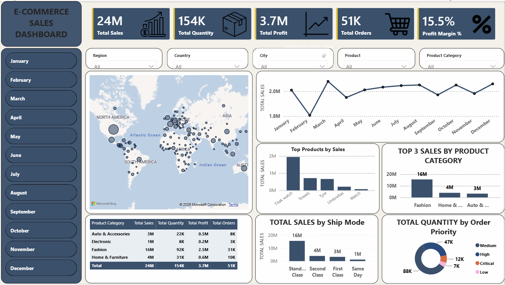
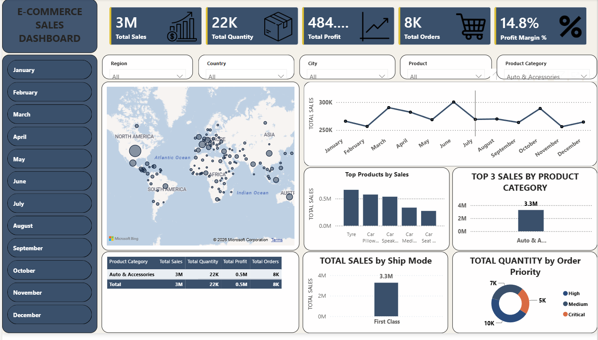
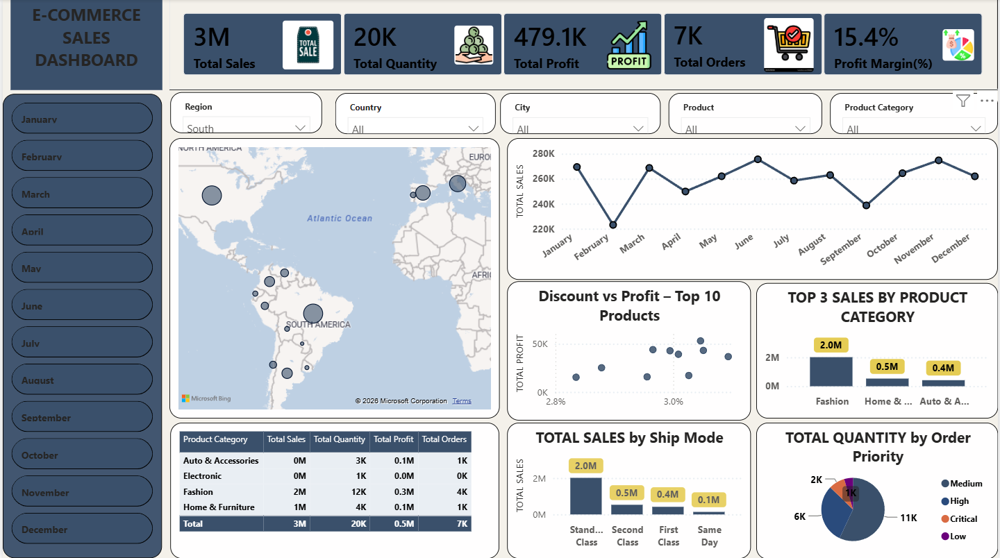

# E-Commerce Sales Dashboard (Power BI)

An interactive Power BI dashboard that analyses global e-commerce sales, profit, order quantity and profit margin across regions, product categories, products and shipping modes.

---

## Problem Statement

An e-commerce business had 51,290 order records across 13 regions and 4 product categories sitting in a flat Excel file, with no single view of how the business was performing. This project builds an interactive dashboard to answer:

- How much are we selling, and how much profit and margin do we make overall?
- Which regions, categories and products drive the most sales?
- Which shipping modes and order priorities carry the most sales and quantity?
- How do sales move month to month?

---

## Dashboard Screenshots

### Overview


### Category Filtered View


### Regional Analysis View (Africa selected)


---

## Dataset

| Item | Detail |
|---|---|
| File | `E_Commerce_Dashboard_Project.xlsx` (sheet: `Sales Data`) |
| Rows / Columns | 51,290 rows, 21 columns |
| Period | Calendar year 2015 |
| Regions | 13 |
| Product categories | Fashion, Home & Furniture, Auto & Accessories, Electronic |
| Key columns | Order ID, Order Date, Ship Date, Aging, Ship Mode, Product Category, Product, Sales, Quantity, Discount, Profit, Shipping Cost, Order Priority, Customer ID, Customer Name, Segment, City, State, Country, Region, Months |

---

## Tools & Skills Used

- **Power BI Desktop:** data model, DAX measures, report design, slicers, map, charts, cards, table
- **DAX:** custom measures (listed below)
- **Excel:** `Working` sheet with `SUMIFS` (month-wise and region-wise sales and profit), `OFFSET` to pick a product category dynamically, and a frequency-bins table

### DAX Measures

| Measure | DAX |
|---|---|
| TOTAL SALES | `SUMX('E-COMMERCE DATA', 'E-COMMERCE DATA'[Sales] * 'E-COMMERCE DATA'[Quantity])` |
| TOTAL QUANTITY | `SUM('E-COMMERCE DATA'[Quantity])` |
| TOTAL PROFIT | `SUM('E-COMMERCE DATA'[Profit])` |
| AVERAGE SALES | `AVERAGE('E-COMMERCE DATA'[Sales])` |
| TOTAL ORDERS | `COUNTROWS('E-COMMERCE DATA')` |
| AVERAGE DISCOUNT | `AVERAGE('E-COMMERCE DATA'[Discount])` |
| PROFIT MARGIN % | `DIVIDE([TOTAL PROFIT], [TOTAL SALES], 0)` |

---

## What the Dashboard Contains

- **KPI cards:** Total Sales, Total Quantity, Total Profit, Total Orders, Profit Margin %
- **Slicers:** Region, Country, City, Product, Product Category and Month buttons (January to December)
- **Global sales map:** geographic spread of sales
- **Monthly sales trend:** line chart across the 12 months
- **Top products by sales:** bar chart
- **Top 3 sales by product category:** bar chart
- **Total sales by ship mode:** bar chart
- **Total quantity by order priority:** donut chart
- **Summary table:** category-wise sales, quantity, profit and orders

---

## Key Findings

### Overall (all regions)

| Metric | Value |
|---|---|
| Total Sales | 24M |
| Total Quantity | 154K |
| Total Profit | 3.7M |
| Total Orders | 51K |
| Profit Margin | 15.5% |

### By product category

| Category | Sales | Quantity | Profit | Orders |
|---|---|---|---|---|
| Fashion | 16M | 92K | 2.5M | 31K |
| Home & Furniture | 4M | 31K | 0.6M | 10K |
| Auto & Accessories | 3M | 22K | 0.5M | 8K |
| Electronic | 1M | 8K | 0.2M | 3K |

### Insights

- **Fashion is the main driver of the business.** It brings 16M of the 24M total sales and 2.5M of the 3.7M profit, far ahead of Home & Furniture (4M) and Auto & Accessories (3M).
- **Standard Class is the most used ship mode** with 16M in sales, followed by Second Class (4M), First Class (3M) and Same Day (1M).
- **Most order quantity is in Medium priority orders** (88K), followed by High (47K), Critical (12K) and Low (7K).
- **Monthly sales stay in a narrow band** of roughly 1.8M to 2.1M. February is the lowest month and March is the highest.
- **Regional drill-down works.** Filtering to Africa shows 2M sales, 14K quantity, 332.2K profit, 5K orders and a 15.8% profit margin, with Fashion again the top category (1.3M).

---

## Repository Structure

```
├── E-COMMERCE SALES DASHBOARD.pbix     # Power BI dashboard file
├── E_Commerce_Dashboard_Project.xlsx   # Dataset + Excel working sheet
├── dashboard_overview.png              # Overview screenshot
├── category_filter_view.png            # Category-filtered screenshot
├── regional_analysis_view.png          # Regional-view screenshot
└── README.md
```

---

## Author

**Shrikant Pedde**
- GitHub: [@shrikantpedde](https://github.com/shrikantpedde)
- LinkedIn: [Shrikant Pedde](https://linkedin.com/in/shrikant-pedde-535b24320/)
